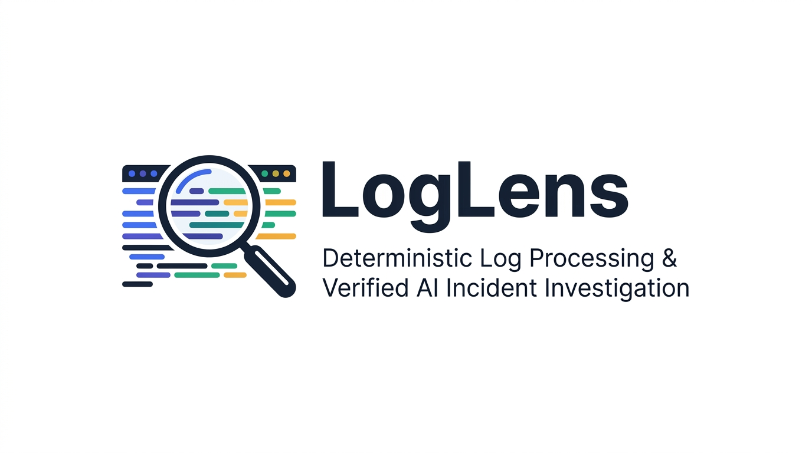
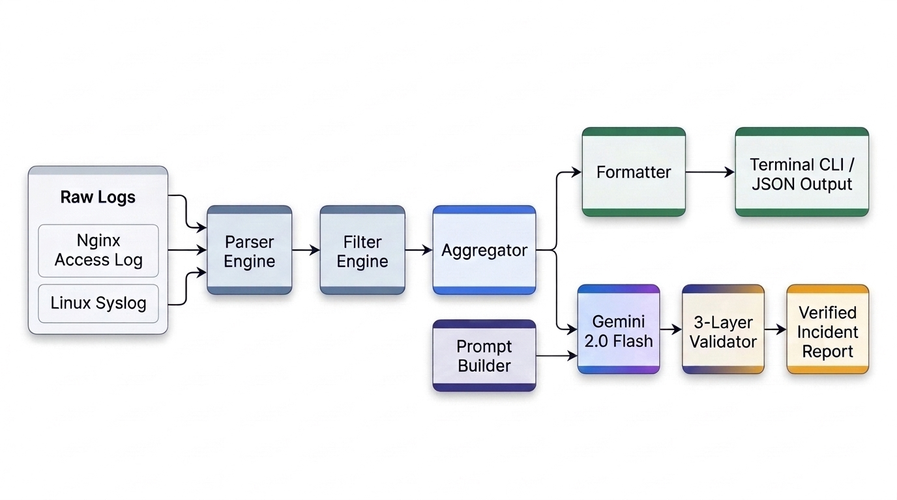

<p align="center">
  
</p>

<p align="center">
  <strong>High-performance deterministic log processing pipeline meets guarded, anti-hallucination AI incident investigation.</strong>
</p>

<p align="center">
  <a href="https://www.python.org/"></a>
  <a href="#"></a>
  <a href="#"></a>
  <a href="#"></a>
  <a href="LICENSE"></a>
</p>

<p align="center">
  <a href="#-quickstart">⚡ Quickstart</a> •
  <a href="#-architecture--pipeline">📐 Architecture & Pipeline</a> •
  <a href="#-key-features">✨ Key Features</a> •
  <a href="#️-the-three-layer-trust-boundary">🛡️ Trust Boundary</a> •
  <a href="#-cli-showcase">💻 CLI Showcase</a> •
  <a href="#-test-suite">🧪 Test Suite</a>
</p>

---

## 🔍 Why LogLens?

Modern production systems output millions of unstructured log lines daily. SREs and developers face an unsustainable dilemma:

| The Naive Approaches | The Failure Mode |
| :--- | :--- |
| **Manual Grep / Awk** | Slow, tedious, and doesn't scale across complex outages or cross-service correlations. |
| **Raw Logs to Generic LLM** | Exceeds token limits, wastes money, and suffers from **severe hallucinations** (invented error counts, fabricated status codes, non-existent stack traces). |

### The LogLens Solution: Dual-Tier Architecture
LogLens bridges deterministic engineering with modern AI reasoning:
1. **$O(N)$ Deterministic Engine (Python OOP):** A compiled regex parser, composable query engine, and linear-time counter extract mathematical ground truth (exact status codes, error distributions, top IPs, hourly volume) at native speed without touching an LLM.
2. **Guarded LLM Investigation (Google Gemini 2.0 Flash):** When `--summarize` is invoked, LogLens injects verified telemetry and sampled evidence into an anti-hallucination prompt. An uncompromising **3-Layer Trust Boundary** verifies every single claim against source logs before printing.

---

## 📐 Architecture & Pipeline

<p align="center">
  
</p>

### Pipeline Breakdown

1. **Ingestion & Auto-Detection:** Automatically sniffs file format and delegates to [`NginxParser`](loglens/parser.py) (Combined Format) or [`SyslogParser`](loglens/parser.py) (RFC 3164 Syslog).
2. **Typed Data Models:** Translates raw strings into immutable, strongly typed [`LogEntry`](loglens/models.py) objects (`NginxAccessEntry` and `SyslogEntry`).
3. **Composable Filtering:** [`FilterEngine`](loglens/filter.py) applies boolean predicates (status code ranges, IP filters, endpoint regexes, system services) in single-pass linear time.
4. **Aggregation:** [`Aggregator`](loglens/aggregator.py) builds statistical counters, frequency distributions, and timeline histograms.
5. **Dual Path Branching:**
   - **Deterministic Path (Fast & Free):** Direct to [`Formatter`](loglens/formatter.py) for ASCII terminal tables or machine-readable JSON.
   - **AI Incident Path (Guarded):** [`PromptBuilder`](loglens/prompt_builder.py) bundles verified facts $\rightarrow$ [`GeminiClient`](loglens/llm_client.py) generates structured analysis $\rightarrow$ [`IncidentValidator`](loglens/validator.py) checks structural integrity, error counts, and verbatim evidence citations.

---

## ✨ Key Features

- **Format Auto-Detection:** Seamlessly parses Nginx access logs and Linux syslog files without manual configuration.
- **Strict Type Safety:** Python 3.10+ dataclasses with optional field handling and full type annotations.
- **Composable Filtering:** Multi-field AND queries (HTTP status code, client IP, path pattern, service name, timestamp ranges).
- **High-Performance Aggregation:** $O(N)$ linear-time counting with `collections.Counter` and min-heap top-N ranking.
- **Zero-Dependency CLI:** Standard library `argparse` orchestrator with standard Unix exit codes (`0` on success, `1` on error).
- **Zero-Hallucination Guarantee:** The LLM cannot invent error metrics or cite log lines that never existed in the source file.

---

## ⚡ Quickstart

### Prerequisites
- Linux or macOS
- Python 3.10+
- Git & Bash

### 1. Clone & Set Up Virtual Environment
```bash
git clone https://github.com/Sarasbari/Loglens.git
cd Loglens

python3 -m venv venv
source venv/bin/activate
pip install -r <(echo "pytest>=8.0.0" && echo "google-genai>=3.0.0")
```

### 2. Run Deterministic Log Analysis (No API key required)
```bash
python -m loglens analyze samples/nginx_sample.log
```

---

## 💻 CLI Showcase

### 1. Core Deterministic Analysis
Analyze traffic breakdown, error counts, and hourly trends:
```bash
python -m loglens analyze samples/nginx_sample.log
```

```text
======================================================
             LogLens Analysis Report             
======================================================
Total Entries Analyzed: 25

--- HTTP Status Code Breakdown ---
  200:   12  ( 48.0%)
  404:    5  ( 20.0%)
  500:    4  ( 16.0%)
  502:    3  ( 12.0%)
  304:    1  (  4.0%)

--- Error Summary ---
  4xx Client Errors: 5
  5xx Server Errors: 7
  Total Data Sent:   1,078,241 bytes

--- Top 5 Client IPs ---
  10.0.0.15          :    5 requests
  10.0.0.22          :    5 requests
  93.180.71.3        :    4 requests
  198.51.100.4       :    4 requests
  203.0.113.88       :    4 requests

--- Top 5 Requested Paths ---
  /api/v1/checkout             :    7 requests
  /api/v1/users                :    3 requests
  /index.html                  :    2 requests

--- Activity by Hour ---
  08:00 :   11 requests [########]
  09:00 :    6 requests [####]
  10:00 :    8 requests [######]
```

### 2. Composable Query Filtering

```bash
# Isolate server crashes (HTTP 500+) on checkout:
python -m loglens analyze samples/nginx_sample.log --min-status 500 --path "/checkout"

# Audit brute-force SSH attacks in Syslog:
python -m loglens analyze samples/syslog_sample.log --service sshd

# Search for kernel panic and OOM killer events:
python -m loglens analyze samples/syslog_sample.log --pattern "oom-kill"
```

### 3. Machine-Readable JSON Export
Pipe directly into `jq`, webhooks, or automation workflows:
```bash
python -m loglens analyze samples/nginx_sample.log --format json | jq '.status_counts'
```

### 4. Verified AI Incident Investigation (`--summarize`)
Export your Gemini API key:
```bash
export GEMINI_API_KEY="your-gemini-api-key"
python -m loglens analyze samples/nginx_sample.log --summarize
```

```text
======================================================
         Verified LLM Incident Analysis (Gemini) 
======================================================
Title:            Checkout Service Upstream Outage
Severity:         HIGH
Affected Service: /api/v1/checkout
Error Count:      12 (Verified ✅)

Summary:
  The checkout endpoint experienced repeated 500 and 502 server errors between
  08:42 and 10:55, caused by upstream connection timeouts and process terminations.

Evidence Cited (Verified against source logs ✅):
  • 10.0.0.22 - - [05/Nov/2026:08:42:19 +0000] "GET /api/v1/checkout HTTP/1.1" 500 240 "-" "MobileApp/2.4"
  • 203.0.113.88 - - [05/Nov/2026:09:20:18 +0000] "POST /api/v1/checkout HTTP/1.1" 502 182 "-" "LogLensClient/1.0"
```

---

## 🛡️ The Three-Layer Trust Boundary

LogLens treats all LLM output as **untrusted input**. Every response must clear three verification gates in [`IncidentValidator`](loglens/validator.py):

| Layer | Check | Verification Method | Enforcement |
|:---:|:---|:---|:---|
| **Layer 1** | **Structural Integrity** | Valid JSON schema, mandatory fields (`title`, `severity`, `error_count`, `summary`, `evidence_lines`). | Rejects malformed output. |
| **Layer 2** | **Mathematical Consistency** | Compares LLM `error_count` directly against deterministically aggregated ground truth. | Rejects if the LLM hallucinated counts. |
| **Layer 3** | **Evidence Grounding** | Scans source logs to confirm every single cited evidence string exists verbatim in the file. | Rejects if the LLM fabricated fake log lines. |

> **Fail-Safe Guarantee:** If the LLM output fails validation, LogLens **never crashes** and never presents unverified claims as truth. It prints the verified deterministic metrics alongside an explicit warning detailing the exact validation failure.

---

## 🧪 Test Suite

LogLens enforces comprehensive test coverage across all pipeline stages:

```bash
source venv/bin/activate
pytest tests/ -v
```

```text
============================= test session starts ==============================
collected 71 items

tests/test_models.py .........                                           [ 12%]
tests/test_parser.py ...............                                     [ 33%]
tests/test_filter.py .............                                       [ 52%]
tests/test_aggregator.py .....                                           [ 59%]
tests/test_cli.py ..........                                             [ 73%]
tests/test_prompt_builder.py ......                                      [ 81%]
tests/test_llm_client.py .......                                         [ 91%]
tests/test_validator.py ......                                           [100%]

============================== 71 passed in 0.35s ==============================
```

*(Note: All LLM unit tests utilize `unittest.mock`. The test suite runs 100% offline, requires no API key, and executes in ~0.35s).*

---

## 📁 Project Structure

```text
Loglens/
├── assets/
│   ├── loglens-banner.png         # Project hero banner
│   └── loglens-architecture.png   # 2D System architecture infographic
├── loglens/                           # Core Python Package
│   ├── __init__.py
│   ├── __main__.py                    # Entrypoint (`python -m loglens`)
│   ├── models.py                      # Typed dataclass schemas
│   ├── parser.py                      # Nginx & Syslog parsers + LogParser facade
│   ├── filter.py                      # Composable query & filter engine
│   ├── aggregator.py                  # Linear-time metrics & distribution counter
│   ├── formatter.py                   # ASCII table & JSON presentation layer
│   ├── prompt_builder.py              # Anti-hallucination prompt generator
│   ├── llm_client.py                  # Google Gemini 2.0 Flash client
│   ├── validator.py                   # 3-Layer Trust Boundary (IncidentValidator)
│   └── cli.py                         # CLI Argument Parser & Orchestrator
├── samples/                           # Baseline test fixtures
│   ├── nginx_sample.log               # 25-line Nginx Combined format sample
│   └── syslog_sample.log              # 25-line Linux Syslog RFC 3164 sample
├── scripts/                           # Phase 1 Unix Pipelines
│   ├── nginx_pipeline.sh              # Bash baseline for Nginx
│   └── syslog_pipeline.sh             # Bash baseline for Syslog
└── tests/                             # 71 Automated Unit & Integration Tests
```

---

## 📄 License

This project is open-source under the [MIT License](LICENSE).
